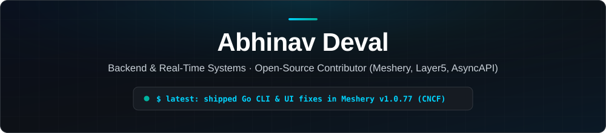
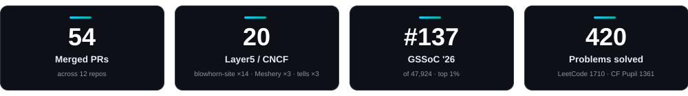

 

<b>Contributing to</b> 

---

## 👋 Hi, I'm Abhinav

Second-year B.Tech ECE student at **IIIT Kalyani** (Class of 2029). I build **backend services, real-time systems and browser-side processing**, and I contribute to **Meshery (CNCF)**, **Layer5 / Blowhorn** and **AsyncAPI**, where I find security, reliability and CI bugs and fix them with tests.

- 🚢 Two of my fixes are in the **[Meshery v1.0.77](https://github.com/meshery/meshery/releases/tag/v1.0.77)** release notes, one in Go and one in the UI.
- 🔐 I closed a CSV formula-injection hole and a Cloudflare Access key-rotation outage in a production worker.
- 🏆 **#137 of 47,924** in GSSoC '26 (top 1%).

**🎯 Looking for:** backend or real-time systems internships, and a GSoC 2027 slot with Layer5/Meshery or AsyncAPI.

**🕒 Based in** India (IST, UTC+5:30) · usually online evenings and weekends · comfortable working async

---

## ⭐ Selected work

| Problem | What I did | Result |
|---|---|---|
| **CSV formula injection.** Signup exports could run cell values as spreadsheet formulas in Excel or Sheets. | Neutralized `=`, `+`, `-`, `@`, tab and CR triggers (including after leading whitespace) and quoted bare CRs to stop row splitting. Followed OWASP CWE-1236. | Merged with tests · [blowhorn-site #496](https://github.com/blowhorn-ai/blowhorn-site/pull/496) |
| **Access key rotation outage.** Valid tokens got 403 after Cloudflare rotated signing keys, until a 10-minute cert cache expired. | Refetch certs once on an unknown `kid`, and still fail closed if it stays unknown. Documented the known limitation in the PR. | Merged, worker suite green · [blowhorn-site #513](https://github.com/blowhorn-ai/blowhorn-site/pull/513) |
| **`mesheryctl` panics.** `environment view` crashed on empty or inconsistent API responses. | Fixed three panics (nil response, empty slice, `TotalCount` mismatch) and added table-driven Go tests. | Shipped in Meshery v1.0.77 · [meshery #23365](https://github.com/meshery/meshery/pull/23365) |
| **Mail scanners unsubscribing users.** A `GET` link prefetched by email security tools unsubscribed people. | `GET` now shows a confirmation page, and only `POST` unsubscribes. Idempotent, with 400/404 behaviour preserved. | Merged · [blowhorn-site #447](https://github.com/blowhorn-ai/blowhorn-site/pull/447) |

**What maintainers said**

> *"Nice, targeted fix for the key-rotation 403s."* — maintainer review on [blowhorn-site #513](https://github.com/blowhorn-ai/blowhorn-site/pull/513)
>
> *"Nice cleanup — this does exactly what it says."* — maintainer review on [tells #28](https://github.com/blowhorn-ai/tells/pull/28)

---

## 💻 Projects

### 🔒 [EnclavePDF](https://github.com/abhinavkdeval08-design/EnclavePDF): compress PDFs in the browser, the file never leaves the tab

[**Live Demo**](https://enclave-pdf.vercel.app) ·    

No backend, no account, no analytics. Switch off Wi-Fi and it still compresses. A Web Worker tries image mode (pdf.js → OffscreenCanvas → JPEG → pdf-lib), then lossless mode, and otherwise returns the original file. Buffers are transferred, not copied, and the worker is terminated after every job.

| File | Mode | Before | After |
|---|---|---|---|
| 37-page sample PDF | Image · Balanced | 10.1 MB | 4.9 MB (52% smaller) |
| Academic calendar | Image · Balanced | 1.5 MB | 235.7 KB (85% smaller) |
| Course syllabus (mostly text) | Lossless | 696 KB | 695.8 KB |

My own test files, one run each: examples, not benchmarks. Image mode rasterizes pages, so text is no longer selectable. Next: per-page text/scan detection.

### 🎧 Vibrodo: a free music app, cloud and local in one queue

   

Plays cloud tracks (YouTube Data API v3) and your own files (FLAC, WAV, ALAC, MP3) from a single queue. **Listening rooms** keep multiple devices in sync over WebSockets by reconciling drift against server time. Built with a team of three across IIIT Kalyani and NIT Durgapur, in development. Source is private, architecture walkthrough on request.

---

## 🛠️ Skills

| | |
|---|---|
| **Languages** | TypeScript, JavaScript, Python, C++, C, Go (contributing to Meshery CLI) |
| **Backend** | Node.js, Express, WebSockets, REST and OpenAPI docs, JWT/OTP auth, Redis, Celery, MongoDB |
| **Frontend & mobile** | React, Next.js, React Native, Web Workers |
| **Cloud & tooling** | Cloudflare Workers and Access, GitHub Actions, Make, Linux, Git |
| **Testing** | Node test runner, table-driven Go tests, CI checks |

---

<b>📂 All open-source work (click to expand)</b>

 

### 🎺 Blowhorn / Layer5 / Meshery (20 merged)

| Area | Impact | PRs |
|---|---|---|
| 🔐 **Security & reliability** | CSV formula injection closed, unsubscribe made safe from mail scanners, Access key rotation no longer returns 403, fleet tables sort correctly | [#496](https://github.com/blowhorn-ai/blowhorn-site/pull/496) · [#447](https://github.com/blowhorn-ai/blowhorn-site/pull/447) · [#513](https://github.com/blowhorn-ai/blowhorn-site/pull/513) · [#507](https://github.com/blowhorn-ai/blowhorn-site/pull/507) |
| 🚢 **Meshery core (CNCF)** | Three `mesheryctl environment view` panics fixed, and an endless UI spinner on empty component schemas. Both in v1.0.77. | [#23365](https://github.com/meshery/meshery/pull/23365) · [#23357](https://github.com/meshery/meshery/pull/23357) |
| ⚙️ **CI & tooling** | Labeler v5 mapped to the real repo layout, CI fixes for unprivileged VMs and non-standard `make` paths, label-commenter cleaned up | [#321](https://github.com/blowhorn-ai/blowhorn-site/pull/321) · [#379](https://github.com/blowhorn-ai/blowhorn-site/pull/379) · [#330](https://github.com/blowhorn-ai/blowhorn-site/pull/330) · [#332](https://github.com/blowhorn-ai/blowhorn-site/pull/332) · [#357](https://github.com/blowhorn-ai/blowhorn-site/pull/357) |
| 🧹 **Templates & community health** | Legacy Meshery references removed, orphan template deleted, support routed to `support@blowhorn.ai` | [site #250](https://github.com/blowhorn-ai/blowhorn-site/pull/250) · [#299](https://github.com/blowhorn-ai/blowhorn-site/pull/299) · [#315](https://github.com/blowhorn-ai/blowhorn-site/pull/315) · [tells #16](https://github.com/blowhorn-ai/tells/pull/16) · [#17](https://github.com/blowhorn-ai/tells/pull/17) · [#28](https://github.com/blowhorn-ai/tells/pull/28) |
| 🎨 **UI & docs** | Accessible dark-mode ink, Open Graph and Twitter cards on docs pages, intro added to Meshery docs | [#476](https://github.com/blowhorn-ai/blowhorn-site/pull/476) · [#478](https://github.com/blowhorn-ai/blowhorn-site/pull/478) · [meshery #22662](https://github.com/meshery/meshery/pull/22662) |

### 🔍 In review

- **mesheryctl-axi** · [#86](https://github.com/meshery-extensions/mesheryctl-axi/pull/86) (CNCF): `system status` printed `provider: null`. Now resolves the provider from config, then the token file, then the server (3 s timeout, auth forwarded), else `Unknown`. Approved by maintainers, all checks passing, awaiting merge.
- **Meshery** · [#23363](https://github.com/meshery/meshery/pull/23363): follow-up to #23357 applying both reviewer notes (shallow copy of the fetched schema, `Array.isArray` guard). Approved, waiting on the final build check.
- **Sistent** · [#1659](https://github.com/layer5io/sistent/pull/1659) FormHelperText, [#1660](https://github.com/layer5io/sistent/pull/1660) SubscriptionTable (CNCF).
- **AsyncAPI CLI** · [#2313](https://github.com/asyncapi/cli/pull/2313): `asyncapi diff` printed an empty `ValidationError` on unparsable files.

### 🌾 Backend work through GSSoC '26 (34 merged)

- **Agri-Vision** (10 PRs): Redis rate limiting and response caching, Celery task queue, Swagger docs, thread-safe model manager.
- **ML-CaPsule** (9 PRs) and **Eventra** (6 PRs): JWT/OTP auth refactor, persistence layer, performance and UI work.
- Plus 9 PRs across Amplitron, DevPath-Web, The-Leetcode-City, Clinical-Insight-Engine, NexaSphere and Auto-Fill-Tool.

### 🧪 How I work

- Every fix starts from a linked issue and ships as a **small, focused PR** with tests.
- Commits are **DCO signed**, and review feedback lands as follow-up commits.
- When a fix has a known limitation, I write it in the PR description.

---

## 🏅 Achievements

<table>
  <tr>
    <td width="33%" valign="top" align="center">
      <h3>🏆 GSSoC '26</h3>
      <h2>#137</h2>
      of 47,924 participants · 25,092 pts · active 13 of 13 weeks
    </td>
    <td width="34%" valign="top" align="center">
      <h3>⚔️ Competitive Programming</h3>
      <h2>420</h2>
      <b>130</b> Easy · <b>176</b> Med · <b>46</b> Hard 
      LeetCode 1710 · Codeforces Pupil 1361 · CodeChef 1137 
      🔥 136-day best streak · 209 active days · 15 contests
    </td>
    <td width="33%" valign="top" align="center">
      <h3>🎓 GFG Campus Mantri</h3>
      <h2>AIR 70</h2>
      out of 2,500
    </td>
  </tr>
</table>

---

## 📫 Let's talk

The fastest way to reach me is [email](mailto:abhinavkdeval08@gmail.com) or [LinkedIn](https://www.linkedin.com/in/abhinavdeval/). I'm happy to walk through any PR above or the Vibrodo architecture.
